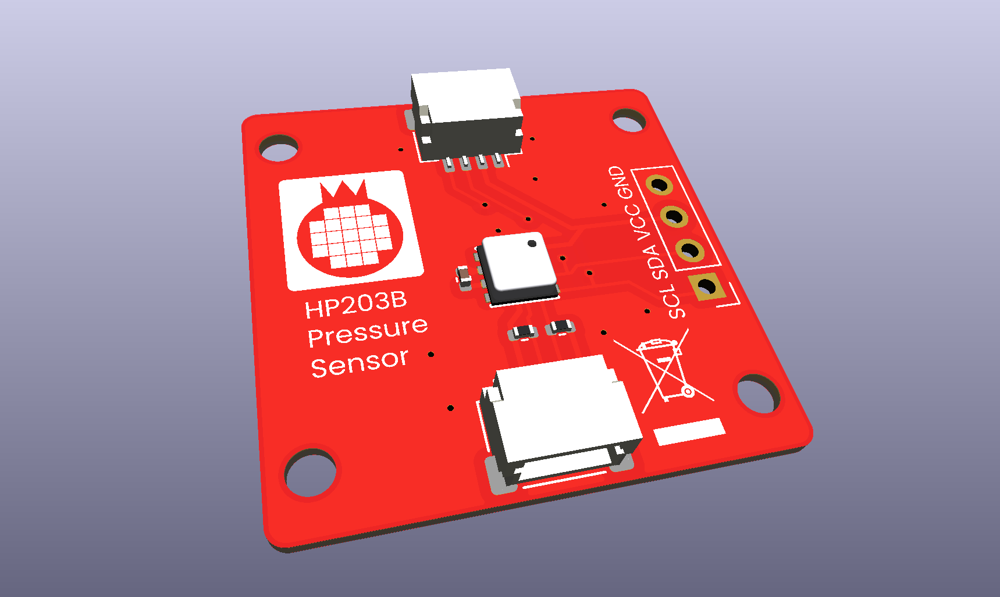
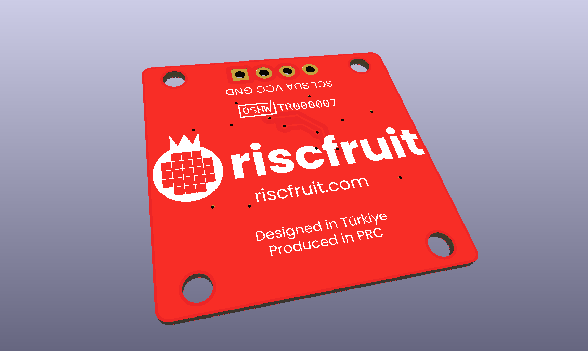

# HP203N-I2C-sensor
Riscfruit HP203N I2C sensor module, measuring barometric pressure and temperature.

### Software
For Micropython or Circuitpython, we have released [HP203B-Library](https://github.com/riscfruit/HP203B-Library).

### Gallery

### License
Copyright (c) 2026, Riscfruit Laboratory. This open source hardware is released under [CERN-OHL-S-2.0](LICENSE).
